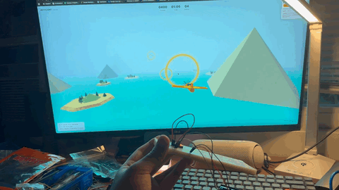
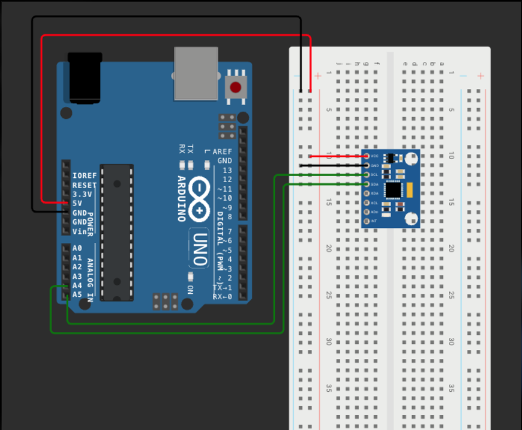

# SkyFlight

SkyFlight is a 3D arcade flight game built with Three.js. Steer a yellow plane through glowing rings using your keyboard or by tilting an Arduino Uno motion controller.

[Play SkyFlight](https://khanhdo1609.github.io/Gyroscope_plane/) · [Watch the 35-second demo](https://khanhdo1609.github.io/Gyroscope_plane/demo.html) · [Download the original MP4](https://github.com/KhanhDo1609/Gyroscope_plane/raw/refs/heads/main/media/skyflight-demo.mp4)

## Quick demo

[](https://khanhdo1609.github.io/Gyroscope_plane/demo.html)

[](media/skyflight-gameplay.png)

## Keyboard controls

| Key | Action |
| --- | --- |
| W / ↑ | Climb |
| S / ↓ | Descend |
| A / ← | Steer left |
| D / → | Steer right |
| Space | Boost |
| P | Pause |
| R | Restart |

## Arduino controller

You’ll need an Arduino Uno, an MPU6500-compatible motion sensor, jumper wires and a USB data cable.

[](media/wiring-screenshot.png)

Match the power and I²C signal levels to your specific sensor breakout. See the [wiring and troubleshooting guide](docs/WIRING.md) for pin assignments and sensor identification.

1. Open [Gyroscope_plane.ino](arduino/Gyroscope_plane/Gyroscope_plane.ino) in Arduino IDE. Select **Arduino Uno** and the board’s USB port, then upload the sketch.
2. Close the Arduino IDE Serial Monitor and Serial Plotter so the browser can use the port.
3. Open the game directly in desktop Chrome. Click **Connect Arduino** and choose the board’s serial port.
4. Hold the sensor level and click **Calibrate**. Tilt left or right to steer and forward or back to change altitude.

The sketch sends newline-delimited `roll,pitch` readings at 115200 baud. The [arduino folder](arduino/) also contains the I²C scanner and sensor identification sketches.

## Run locally

```sh
git clone https://github.com/KhanhDo1609/Gyroscope_plane.git
cd Gyroscope_plane
python3 -m http.server 8000
```

Open [the game](http://localhost:8000/) or [the demo page](http://localhost:8000/demo.html). The game loads Three.js from a CDN.
