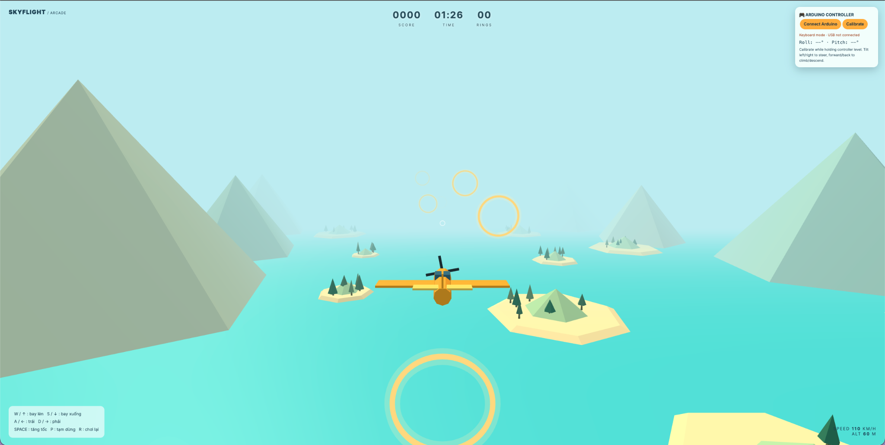

# ✈️ SkyFlight — Arduino Motion-Controlled 3D Game

A small **3D arcade flight game** built with **Three.js**, controlled either by your keyboard or by tilting a motion sensor connected to an **Arduino Uno**. Fly over low-poly islands and mountains, steer through glowing rings, and earn points.

**Project status:** The playable browser game and Arduino source code are in this repository. Screenshot and recorded video assets are prepared for upload; their links below will work once the two files are added to `media/`. GitHub Pages must be enabled once to publish the online playable demo.

## 🎮 Play the demo

**[Open the SkyFlight browser demo](https://khanhdo1609.github.io/Gyroscope_plane/)** *(requires GitHub Pages to be enabled)*

To publish: Repository **Settings → Pages → Build and deployment → Deploy from a branch → main → / (root) → Save**. Wait for GitHub to finish deploying.

Visitors can play **with a keyboard only**; no Arduino is required. Arduino motion control works in a supported desktop Chrome browser with a connected board, using Web Serial.

## 📷 Screenshot



## 🎬 Gameplay video

Once `media/skyflight-demo.mp4` is uploaded, viewers can **[watch the gameplay video](media/skyflight-demo.mp4)** or **[download the MP4](https://github.com/KhanhDo1609/Gyroscope_plane/raw/refs/heads/main/media/skyflight-demo.mp4)**. On GitHub, the MP4 file page may also show a built-in video player.

For a video player directly on the deployed website, open [the gameplay video](media/skyflight-demo.mp4) from the demo page. Browser playback depends on supported codecs.

## 🧰 Hardware and wiring

- Arduino Uno R3
- MPU6500-compatible motion sensor (original module was labeled MPU6050; its `WHO_AM_I` value was **0x70**)
- 4 jumper wires and a USB cable

| Sensor | Arduino Uno |
| --- | --- |
| SDA | A4 |
| SCL | A5 |
| GND | GND |
| VCC | Compatible power source — see note below |

**Electrical safety:** The sensor chip is a 3.3V device. Some breakout boards accept 5V supply, but 5V I²C logic is not guaranteed. Confirm the breakout's specifications, and use a suitable 3.3V supply/logic-level shifter if needed. More details: [wiring guide](docs/WIRING.md).

## 🚀 How to run

### 1. Upload the Arduino code

Open **[Gyroscope_plane.ino](arduino/Gyroscope_plane/Gyroscope_plane.ino)** in Arduino IDE. Select **Arduino Uno** and the correct USB port, then click **Upload**. The sketch uses the built-in `Wire.h` library and sends `roll,pitch` readings at **115200 baud**.

> If the I²C address is `0x69`, change `const byte MPU = 0x68;` accordingly.

### 2. Run the web game locally

```bash
git clone https://github.com/KhanhDo1609/Gyroscope_plane.git
cd Gyroscope_plane
python3 -m http.server 8000
```

Open **http://localhost:8000/index.html** in **Google Chrome**. Internet access is needed to load Three.js from its CDN.

### 3. Connect the motion controller (optional)

1. Close Arduino IDE's **Serial Monitor / Serial Plotter**.
2. Keep Arduino connected to your computer over USB.
3. Click **Connect Arduino** inside the game.
4. Select the Arduino serial port (for example `cu.usbmodem11301`).
5. Hold the sensor level and click **Calibrate**.
6. Tilt left/right to steer and forward/back to climb/descend.

If you do not have the hardware, just use the keyboard.

## ⌨️ Keyboard controls

| Key | Action |
| --- | --- |
| W / ↑ | Climb |
| S / ↓ | Descend |
| A / ← | Steer left |
| D / → | Steer right |
| Space | Boost |
| P | Pause |
| R | Restart |

## 📁 Project files

```text
Gyroscope_plane/
├── index.html                      # Playable Three.js game + Web Serial
├── arduino/
│   ├── Gyroscope_plane/
│   │   └── Gyroscope_plane.ino     # Uploaded Arduino IDE sketch
│   ├── MPU6500_Flight_Controller/  # Earlier controller sketch
│   ├── I2C_Scanner/                # Check I2C connection
│   └── WHO_AM_I_Check/             # Identify sensor chip
├── docs/WIRING.md                  # Wiring + troubleshooting
├── media/                          # Add screenshot + gameplay MP4
└── README.md
```

## 🔧 Troubleshooting

- **MPU6050 ERROR:** The original sensor reported `WHO_AM_I = 0x70`, which may be rejected by the Adafruit MPU6050 library. Use the direct-register sketch included here.
- **No I²C devices found:** Check SDA/A4, SCL/A5, GND, power, and solder joints.
- **Chrome serial permissions error:** Open the game directly in desktop Chrome at `localhost`, not inside an embedded preview.
- **Serial port unavailable:** Close Serial Monitor/Plotter and reconnect.
- **404 on localhost:** Start the Python server from the folder containing `index.html`.

**Tech stack:** Arduino C++, I²C, Web Serial API, HTML/CSS/JavaScript, Three.js.

*Demo is a personal educational project. Hardware/browser compatibility has not been tested on every device.*
